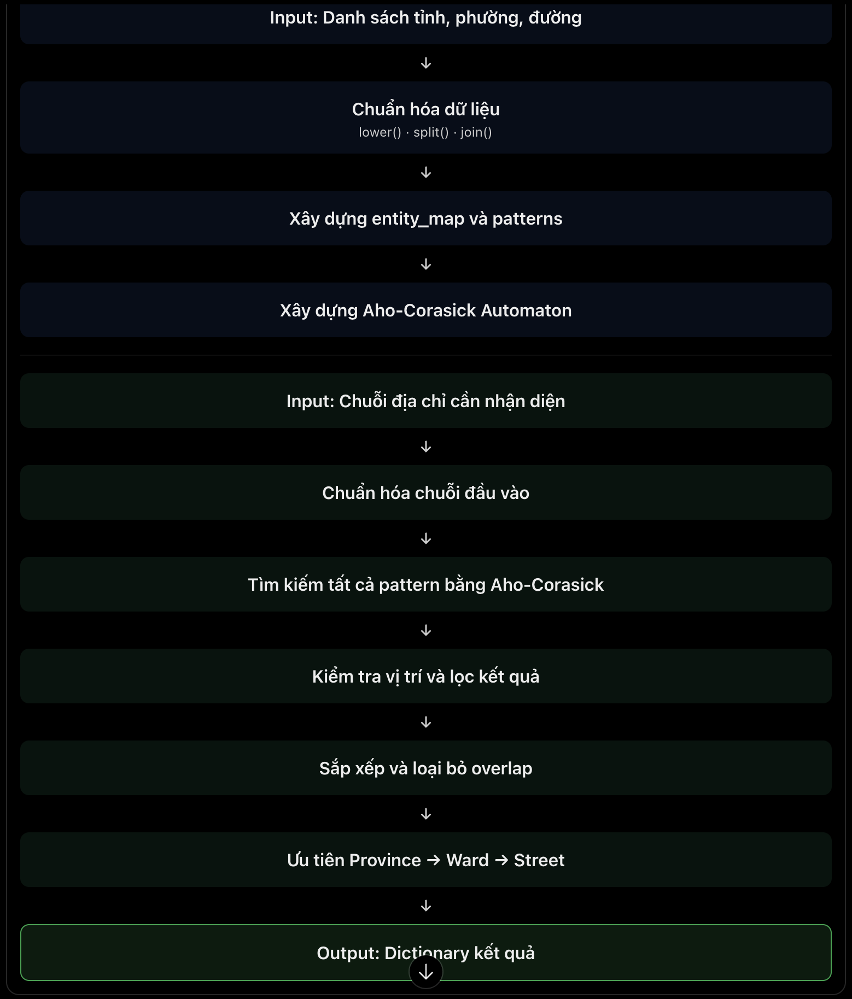

# Group_02 – Address Segmentation Project
Advance Algorithm Course 261 Assignment
[]([https://github.com/ZenTonia2k5/Mocap-Project/raw/main/Multidisciplinary_Project.pdf](https://github.com/ZenTonia2k5/AS_Project))

This program identifies **provinces, wards, and streets** from address strings using the **Aho-Corasick** algorithm (`daachorse`).

## Processing Flow



## Run with Google Colab

1. Open [`Group_02.ipynb`](https://colab.research.google.com/drive/1zrGDObIwB3exO5nfQoMPCgaU-3LvGQ_4), or upload the notebook to [Google Colab](https://colab.research.google.com/).
2. Select **Runtime → Run all**.
3. The notebook automatically installs the required libraries, downloads the test data and database from Google Drive, and runs the evaluation.
4. Once execution is complete, the output file `Group_02.xlsx` is generated. It contains two sheets: `summary` and `details`.

An Internet connection is required to download the test data given from Google Drive.

## Run with Python (.py)

### 1. Prepare the environment

Install Python and open a Terminal in the project directory. It is recommended to create a virtual environment:

```bash
python -m venv .venv
```

Activate the environment:

**macOS / Linux**
```bash
source .venv/bin/activate
```

**Windows**
```powershell
.venv\\Scripts\\activate
```

Install the required libraries:

```bash
python -m pip install --upgrade pip
python -m pip install daachorse pandas xlsxwriter editdistance gdown
```

### 2. Prepare the data files

Place the following files in the same directory as `Group_02.py`:

```text
test.json
list_province.txt
list_ward.txt
list_street.txt
```

You can download these files by running the following commands in Terminal:

```bash
gdown --fuzzy "https://drive.google.com/file/d/18qzaHmx9-fcKPi4gTq304G2JvXy_g6XW/view?usp=sharing" -O test.json
gdown --fuzzy "https://drive.google.com/file/d/1PHRkRLRaO2vFivLbcPJsaxjvZ7K_I3lU/view?usp=drive_link" -O list_province.txt
gdown --fuzzy "https://drive.google.com/file/d/1QrSouYn6IUEW7Impje1vOxzsksjlAJ-h/view?usp=drive_link" -O list_ward.txt
gdown --fuzzy "https://drive.google.com/file/d/1yP2dBE8K9QtUiaLPewtQRr-hDH0gOgfa/view?usp=drive_link" -O list_street.txt
```

### 3. Run the script

**Note:** `Group_02.py` is exported from the Colab notebook and currently contains notebook shell commands beginning with `!` (such as `!pip`, `!rm`, and `!gdown`). These commands are not valid in a standard Python script. Run the installation and download commands above in Terminal, then remove the corresponding lines beginning with `!` from `Group_02.py` before running it.

Run:

```bash
python Group_02.py
```

The script saves the evaluation workbook `Group_02.xlsx` in the current directory.

## Output

`Solution.process(address)` returns in format:

```python
{
    "province": "Ho Chi Minh",
    "ward": "Ben Nghe",
    "street": "Nguyen Hue"
}
```

A field is set to `None` if no matching entity is selected.
