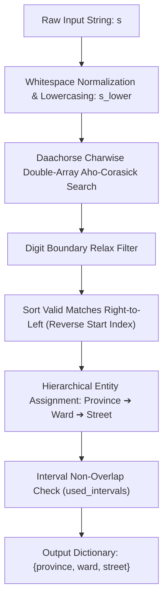

# Vietnamese Address Segmentation (9.92 Solution)

A high-performance Vietnamese address segmentation engine based on **Double-Array Aho-Corasick** and **Hierarchical Spatial Matching**, implemented in [`address_segmentation_9.92.py`](file:///d:/GitHub/AS_Project/address_segmentation_9.92.py).

This solution parses unstructured, unpunctuated, or noisy Vietnamese address strings into structured administrative components: **Province** (`province`), **Ward** (`ward`), and **Street** (`street`).

---

## 📌 Architecture & Algorithm Overview



### Key Technical Mechanisms in `9.92`

1. **Entity Map & Homonym Resolution (`entity_map`)**:
   - Entities from all three dictionaries (`list_province`, `list_ward`, `list_street`) are normalized (lowercased, excess whitespace stripped) and mapped to their original strings.
   - When the same name appears across multiple administrative categories (e.g., *"Hồng Hà"* as both a ward and a street, or *"Lào Cai"* as both a province and a street), `entity_map` stores all candidate types under the single key:
     ```python
     self.entity_map[name_lower] = {
         "ward": "Phường Hồng Hà",
         "street": "Đường Hồng Hà"
     }
     ```
   - This prevents key collisions while maintaining the original canonical casing.

2. **Fast Multi-Pattern Matching (`daachorse`)**:
   - Employs `daachorse.CharwiseDoubleArrayAhoCorasick` with `match_kind=daachorse.MATCH_KIND_LEFTMOST_LONGEST`.
   - Optimized for Unicode characters (Vietnamese diacritics), enabling $O(N)$ string matching where $N$ is the length of the query string.

3. **Relaxed Digit-Boundary Verification (`Boundary relax logic`)**:
   - Naive word boundary checks (e.g. `isalnum()`) inadvertently drop valid street or ward names when adjacent to slashes (`/`), punctuation, or compound words.
   - The **9.92** algorithm uses a targeted digit boundary filter: a match is only invalidated if **both** the neighboring character in the text and the boundary character of the candidate pattern are digits:
     ```python
     # Left boundary check
     if start > 0 and s_lower[start-1].isdigit() and pat_str[0].isdigit():
         left_ok = False
     # Right boundary check
     if end < len(s_lower) and s_lower[end].isdigit() and pat_str[-1].isdigit():
         right_ok = False
     ```
   - This accurately prevents numbered streets (e.g., *"Đường 1"*) from falsely matching inside house numbers (e.g., *"103"*, *"423/18"*), while preserving valid matches adjacent to letters, slashes, and symbols.

4. **Right-to-Left (RTL) Spatial Traversal**:
   - Standard Vietnamese address grammar specifies locations from local to regional:
     $$\text{House Number} \longrightarrow \text{Street} \longrightarrow \text{Ward} \longrightarrow \text{Province}$$
   - Matches are sorted in descending order of their start index (`start` position):
     ```python
     valid_matches.sort(key=lambda x: x[0], reverse=True)
     ```
   - Ensures that more general administrative units appearing towards the end of the string are prioritized and disambiguated correctly.

5. **Greedy Disambiguation with Interval Non-Overlap**:
   - Iterates through the hierarchy `["province", "ward", "street"]`.
   - The first match for each entity type that does not overlap with previously occupied intervals (`used_intervals`) is assigned.
   - Prevents substring contamination (e.g., a street name claiming characters belonging to a ward or province).

---

## 🛠️ Prerequisites & Installation

The solution requires Python 3.9+ and the `daachorse` package:

```bash
pip install daachorse
```

---

## 💻 API Reference & Usage

### Class: `Solution`

#### `__init__(list_province: list[str], list_ward: list[str], list_street: list[str])`
Initializes the entity map and builds the charwise double-array Aho-Corasick automaton.

#### `process(s: str) -> dict[str, str | None]`
Parses an input address string and returns segmented components.

### Example

```python
import daachorse
from address_segmentation_9_92 import Solution

# 1. Initialize dictionaries
provinces = ["Thành phố Hồ Chí Minh", "Thành phố Hà Nội", "Tỉnh Long An"]
wards = ["Phường Bến Nghé", "Phường Bến Thành", "Xã Long Hậu"]
streets = ["Nguyễn Huệ", "Lê Lợi", "Quang Trung"]

solution = Solution(
    list_province=provinces,
    list_ward=wards,
    list_street=streets
)

# 2. Process an address string
raw_address = "Số 12 Lê Lợi, Phường Bến Nghé, Thành phố Hồ Chí Minh"
result = solution.process(raw_address)

print(result)
# Output:
# {
#     "province": "Thành phố Hồ Chí Minh",
#     "ward": "Phường Bến Nghé",
#     "street": "Lê Lợi"
# }
```

---

## ⏱️ Complexity Analysis

| Phase | Time Complexity | Space Complexity | Notes |
|---|---|---|---|
| **Build Automaton (`__init__`)** | $O(\sum |P_i|)$ | $O(\sum |P_i|)$ | Compact Double-Array representation via `daachorse` |
| **Search & Filtering (`process`)** | $O(|S| + K)$ | $O(K)$ | $|S|$ is input length; $K$ is number of matches |
| **Interval Assignment** | $O(K \log K + M \cdot K)$ | $O(K)$ | $M = 3$ (entity types: province, ward, street) |

